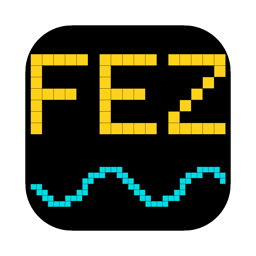
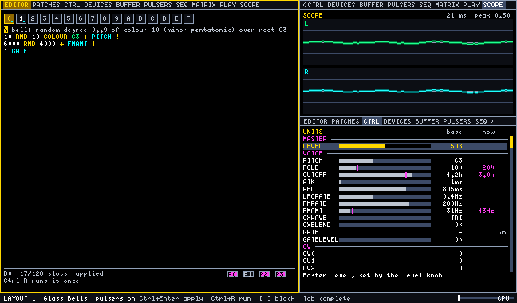

# FEZ: Personal Sound Computer

*a forth programmable virtual analog synth engine*

FEZ is a synthesiser you program. One voice makes the sound; a few lines of a small Forth-like language decide what the voice does and when. It is built for slow, layered, ambient music: tape loops, long delays, drones that drift.

You write a line such as `C4 PITCH !`, press a key, and the note changes. Everything the sound depends on is a named number, called a register, and everything can be reached from code, from a list of knobs, or from a modulation matrix.

## Where it runs

- **macOS** (Apple Silicon): a signed-ad-hoc `FEZ.app` in a dmg.
- **Windows** (64-bit): one `FEZ.exe`.
- **Linux**: build from source (needs SDL2); aimed at a Raspberry Pi with a small screen.
- **TrimUI Brick**: a handheld version with its own button-driven screens.
- **iPad**: in progress, in a separate wrapper project.

Downloads are on the GitHub releases page.

## What is in it

- **A language of 46 words** with a stack, sixteen blocks of code, sixteen scratch registers and saturating 16-bit arithmetic (numbers stick at the ends instead of wrapping, which is what you want for sound).
- **A voice** in the west-coast tradition: a complex oscillator with FM from a second oscillator, a wavefolder and a vactrol-style lowpass gate. A separate, never-gated mod voice (oscillator or noise through a Moog-style ladder filter) handles drones and sweeps.
- **Space**: a tape delay (up to 12 seconds, with wow, hiss, a feedback lowpass and freeze), a stereo spring, and a fixed compressor.
- **A buffer device** that records and replays up to 30 seconds, with grains.
- **Four pulsers** that fire blocks on their own clocks, and a **modulation matrix** of 16 routes.
- **Devices that make notes and movement**: a cellular automaton, a Lorenz attractor, an 8-step sequencer, a scale quantiser, a Turing machine and a keyboard.
- **Sixteen modulation pots** (`MP0` to `MP15`), ready for knobs and, later, MIDI. On the handheld the two analogue sticks are `MP0` to `MP3`.
- **Fourteen example patches**, and patches saved as plain text files.

The core is portable C with no allocation and no operating system calls. Two front ends sit on top of it: a desktop app (macOS, Windows, Linux) and a handheld version for the TrimUI Brick. Both draw the same screens into a pixel array.

## Build and run

You need a C compiler and SDL2.

    make test           # the tests; must end "all tests ok"
    make && ./fez       # the desktop app
    make manual         # builds docs/manual.html

Patches and recordings live in `~/FEZ/` (`patches/` and `recordings/`).

## The TrimUI Brick

    brick/build.sh      # needs Docker (Colima is fine); leaves dist/FEZ.pak

Copy the `FEZ.pak` folder to the card as `Tools/tg5040/FEZ.pak`, put the card in the Brick, and start FEZ from the Tools menu. It works with NextUI and MinUI. On the Brick's own (stock) firmware, copy `dist/trimui/Apps/FEZ` into `Apps/` on the card instead; FEZ then appears under Apps. The handheld chapter of the manual has the button layout.

## The Mac app

    make mac-dmg VERSION=0.1.0     # dist/FEZ-mac-v0.1.0.dmg (or mac-zip for a zip)

This builds `FEZ.app` with SDL2 linked into the program (so no Homebrew or SDL2 is needed to run it) and the icon from `mac/`. The app is signed ad hoc, not with an Apple Developer ID, so on a Mac that did not build it the first launch needs a right-click, then Open. Or run `xattr -dr com.apple.quarantine FEZ.app` once.

## Windows

    brew install mingw-w64         # once, on the Mac
    make win-sdl                   # once: SDL2's MinGW package, into ~/sdk
    make win-zip VERSION=0.1.0     # dist/FEZ-win-v0.1.0.zip, holding one FEZ.exe

Cross-built on the Mac as one `FEZ.exe` with SDL2 inside. Patches and recordings go in `C:\Users\<you>\FEZ`. The exe is not signed, so Windows SmartScreen shows "Windows protected your PC": choose More info, then Run anyway.

## Releases

Build the Brick pak (`brick/build.sh`), then `make brick-zip`, `make mac-dmg` and `make win-zip` with the same `VERSION=`, and attach the files in `dist/` to a GitHub release (`gh release create v0.1.0 dist/FEZ-*-v0.1.0.*`).

## Documentation

Read it online at **https://jonphilpott.github.io/fez/**, or open `docs/manual.html` in a browser. It is one page: a first-sound walkthrough, the language, the voice, devices, playing, the handheld, the example patches, and a full word and register reference (generated from the code, so it cannot drift).

`CLAUDE.md` describes the layout of the source and the rules of the code, for anyone (or any agent) who works on it.

## Layout

    core/       the portable core: VM, registers, synth, devices, buffer, effects
    desk/       the desktop app (SDL2) and the shared screen code
    brick/      build script and launch scripts for the Brick
    test/       tests, including golden vectors
    tools/      manual generator, screenshot and rendering tools
    docs/       manual chapters, style, screenshots and the built manual.html
